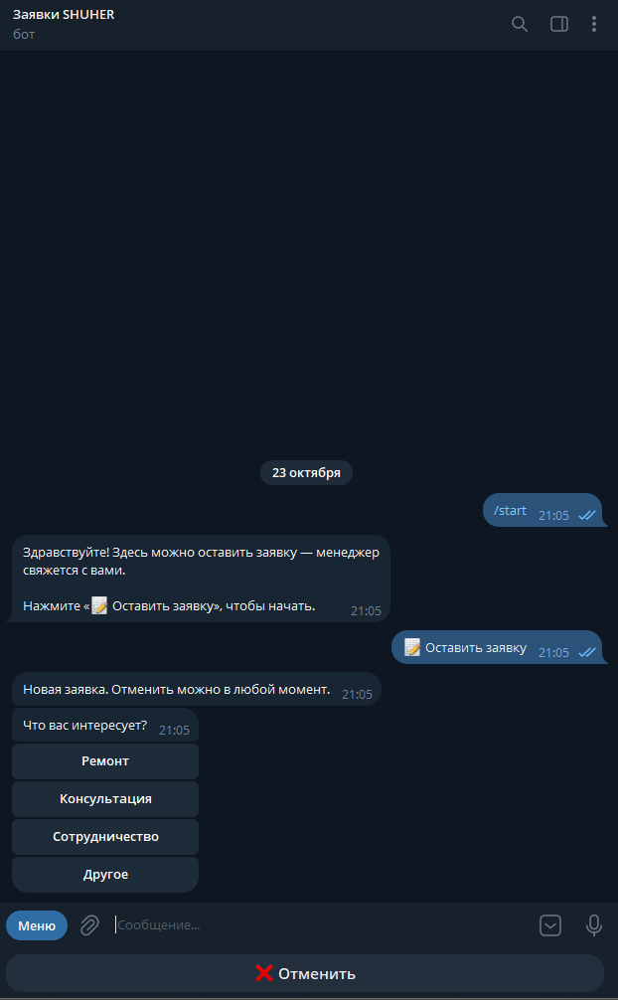
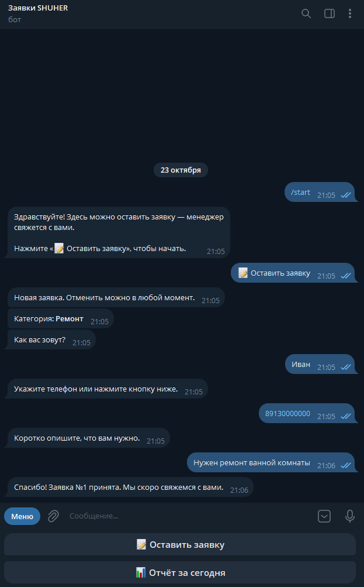
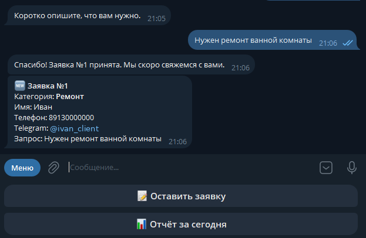
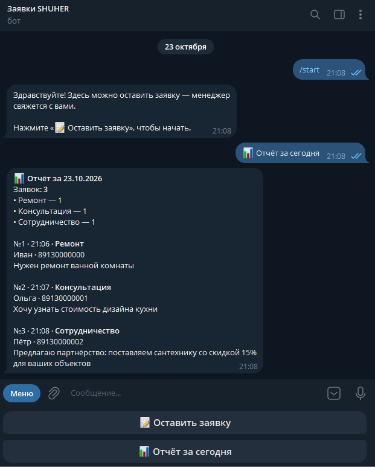
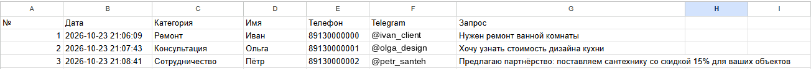

# Lead Bot — Telegram-бот для приёма заявок

[](https://github.com/SHUHER322/lead_bot/actions/workflows/tests.yml)

Клиент нажимает «📝 Оставить заявку» и проходит короткую анкету (категория → имя → телефон → запрос), заявка сохраняется
в базу и дублируется в Google Таблицу, менеджер мгновенно получает уведомление
в Telegram. Каждый вечер менеджер получает сводку заявок за день,
а командой `/report` — в любой момент.

**Стек:** Python 3.11–3.14, aiogram 3, SQLite (aiosqlite), Google Sheets API (gspread), Docker.

## Как это выглядит

<table>
  <tr>
    <th>Клиент выбирает категорию</th>
    <th>Анкета целиком</th>
  </tr>
  <tr>
    <td></td>
    <td></td>
  </tr>
  <tr>
    <th>Уведомление менеджеру</th>
    <th>Отчёт за день</th>
  </tr>
  <tr>
    <td></td>
    <td></td>
  </tr>
</table>

Каждая заявка сразу появляется в Google Таблице:



## Возможности

- Анкета с кнопками: категория → имя → телефон (текстом или кнопкой «Отправить номер») → запрос
- Проверка ввода: длина имени, формат телефона (10–15 цифр), отмена на любом шаге
- Категории заявок задаются в `.env` — под нового заказчика код не меняется
- Мгновенное уведомление менеджеру в Telegram — одному или нескольким
  (`MANAGER_CHAT_ID=123456789,987654321`); если один заблокировал бота, остальные всё равно получат
- Хранение в SQLite + копия в Google Таблице; сбой Google не ломает приём заявки
- Ежедневный отчёт по часовому поясу заказчика и кнопка «Отчёт за сегодня» для менеджера
- Тесты на pytest с автозапуском в GitHub Actions, запуск в Docker

## Запуск

```bash
python -m venv .venv             # на Windows с несколькими Python: py -V:3.14 -m venv .venv
source .venv/bin/activate        # Windows: .venv\Scripts\activate
pip install -r requirements.txt
cp .env.example .env             # Windows: copy .env.example .env
# заполнить BOT_TOKEN и MANAGER_CHAT_ID в .env
python -m bot.main
```

### Быстрый запуск на Windows

- **Двойной клик по `run.bat`** — бот запустится в отдельном окне.
- **F5 в VS Code** — запуск с отладкой (конфигурация «Запустить бота»).

## Google Таблица (необязательно)

1. В Google Cloud Console создать проект и включить Google Sheets API.
2. Создать сервисный аккаунт, скачать JSON-ключ и положить его в корень
   проекта как `credentials.json`.
3. Создать таблицу и выдать почте сервисного аккаунта (`client_email`
   из ключа) права редактора.
4. Вписать ID таблицы в `.env` → `SPREADSHEET_ID`.

Заголовки столбцов бот добавит сам. Если таблица недоступна, заявки всё равно
сохраняются в базу.

## Ежедневный отчёт

В `.env` задаются часовой пояс заказчика и время отчёта:

```
TIMEZONE=Asia/Tomsk
REPORT_TIME=20:00
```

Отчёт приходит по поясу заказчика, где бы ни был запущен бот. Время заявок
в базе и таблице тоже пишется по этому поясу. Команда `/report` доступна только
менеджерам из `MANAGER_CHAT_ID` (один ID или несколько через запятую), им же приходит
вечерний отчёт.

## Категории заявок

Клиент выбирает категорию кнопками под сообщением. Список задаётся в `.env`,
под нового заказчика код менять не нужно:

```
CATEGORIES=Ремонт,Консультация,Сотрудничество,Другое
```

Категория попадает в уведомление, базу, отдельный столбец таблицы
(удобно фильтровать: Данные → Создать фильтр) и в отчёт с подсчётом
по каждой категории.

## Структура

```
bot/
  config.py    — настройки из .env
  db.py        — таблица заявок и запись в неё
  states.py    — шаги анкеты (FSM)
  keyboards.py — кнопки меню
  sheets.py    — выгрузка заявок в Google Таблицу
  report.py    — ежедневный отчёт и команда /report
  notify.py    — отправка уведомлений и отчётов всем менеджерам
  handlers.py  — диалог с клиентом и уведомление менеджеру
  main.py      — запуск бота
```

## Запуск в Docker (сервер)

На сервере нужны Docker и Docker Compose. В папке проекта:

```bash
cp .env.example .env          # заполнить токен, chat id и остальное
# положить рядом credentials.json (если нужна Google Таблица)
mkdir -p data                 # здесь будет лежать база
docker compose up -d --build  # собрать и запустить в фоне
```

Полезные команды:

```bash
docker compose logs -f        # логи в реальном времени (выход: Ctrl + C)
docker compose ps             # работает ли бот
docker compose restart        # перезапустить
docker compose up -d          # применить изменения в .env
docker compose down           # остановить
git pull && docker compose up -d --build   # обновить код
```

База хранится в `data/leads.db` на сервере и не теряется при пересборке.
Бот сам поднимается после падения и перезагрузки сервера.

> Без Google Таблицы: уберите из `docker-compose.yml` строку
> с `credentials.json` и оставьте `SPREADSHEET_ID` пустым.
